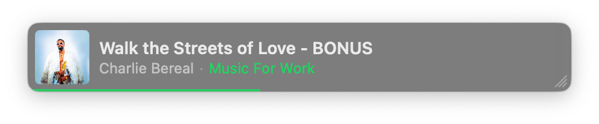

<div align="center">

# Minamp

**A tiny always-on-top Spotify controller for macOS.**

Shrink it to a sliver beside your other windows. Rest the mouse on it and your playlists,
liked songs and search open above it. Move away and it tucks back down.



</div>

---

## What it does

- **A strip you can make any size.** Drag the grip in its bottom-right corner, down to just the album art. Drag anywhere else on it to move it. It stays on top of other windows and remembers where you put it.
- **Hover for controls.** Back, play/pause and next appear on the strip as soon as the mouse is on it.
- **Rest for half a second and the library opens**, beside the strip without moving it:
  - **Playlists:** click one to see its songs, or ▶ to play it.
  - **Liked:** your liked songs.
  - **Search:** songs, albums and playlists.
  - A seek bar, shuffle, repeat and volume.
- **See what you're playing from.** The playlist or album shows in green next to the artist; click it to jump there.
- **Folders.** Spotify doesn't share its playlist folders with other apps, so Minamp has its own: right-click a playlist → **Move to Folder**.
- **Menu bar icon** (three bars) to hide, show or quit it, and to have it open at login.

Playback runs through the Spotify app on your Mac, so it has to be installed. Browsing your
library needs a free Spotify developer app of your own. Setup below takes about five minutes.

## What you need

- A Mac on macOS 14 (Sonoma) or later
- The [Spotify desktop app](https://www.spotify.com/download/mac/), signed in
- **Spotify Premium.** Spotify only lets Premium accounts own a developer app.

## Setup

### 1. Install

Open **Terminal** (⌘ Space, type "Terminal") and paste this:

```bash
mkdir -p ~/Applications && curl -fsSL -o /tmp/Minamp.zip https://github.com/TheBeachman/minamp/releases/latest/download/Minamp.zip && ditto -x -k /tmp/Minamp.zip ~/Applications && open ~/Applications/Minamp.app
```

It puts Minamp in your Applications folder and opens it. A strip appears in the bottom-right
corner of your screen, with a three-bar icon in the menu bar.

The first time it starts, macOS asks whether Minamp can control Spotify. Click **Allow**.
(If you clicked Don't Allow: System Settings → Privacy & Security → Automation → Minamp →
turn on Spotify.)

Play, pause and skip work now. The next steps connect your library.

### 2. Make your Spotify developer app

1. Go to [developer.spotify.com/dashboard](https://developer.spotify.com/dashboard) and log in
   with **your** Spotify account. Accept the developer terms if it asks.
2. Click **Create app** and fill in:
   - **App name:** Minamp (or anything)
   - **App description:** anything
   - **Redirect URI:** `http://127.0.0.1:8973/callback`, then click **Add**
   - **Which API/SDKs are you planning to use?** tick **Web API**
3. Tick the terms box and click **Save**.
4. On the app's page, open **Settings** and copy the **Client ID**.

### 3. Connect Minamp

1. Hover over the Minamp strip until the library opens.
2. Paste the Client ID into the box (⌘V, or the **Paste** button).
3. Click **Connect**. Your browser opens Spotify's approval page. Check it shows your
   account, then click **Agree**.

Your playlists appear. You're done.

## Everyday use

| To | Do this |
|---|---|
| Keep the library open | Menu bar icon → **Keep Expanded** |
| Resize | Drag the three-line grip on the strip, or on the library's far corner |
| File a playlist in a folder | Right-click it → **Move to Folder** |
| Rename or delete a folder | Right-click the folder |
| Hide it / bring it back | Menu bar icon → **Hide Minamp** / **Show Minamp** |
| Start it at login | Menu bar icon → **Open at Login** |
| Quit | Menu bar icon → **Quit Minamp** |

## Good to know

- **Playlists you follow but didn't make** show up and play, but Spotify only lists the songs
  in playlists you own.
- **Your data stays on your Mac.** Minamp talks only to the Spotify app and to Spotify's own
  servers. Your sign-in, folders and playlist list are saved in
  `~/Library/Application Support/Minamp`, in a folder only your user account can open.
- **Wrong account, or starting over:** right-click the strip → **Reset Spotify Setup…**
- **Updating:** quit Minamp, then run the install command from step 1 again. Your settings and
  folders are kept. macOS may ask once more to let Minamp control Spotify.
- **Uninstall:** quit it, then delete `~/Applications/Minamp.app` and
  `~/Library/Application Support/Minamp`.

## Build it yourself

You need Apple's Command Line Tools (`xcode-select --install`); full Xcode isn't required.

```bash
git clone https://github.com/TheBeachman/minamp.git
cd minamp
./build.sh --open
```

`./build.sh --release` makes a universal (Apple Silicon + Intel) `build/Minamp.zip`.

The app is ad-hoc signed, not notarized. The install command above uses `curl`, which doesn't
mark the download as quarantined, so macOS opens it without a warning. If you download the zip
in a browser instead, right-click the app → **Open** the first time.

## License

GPL-3.0. See [LICENSE](LICENSE).
